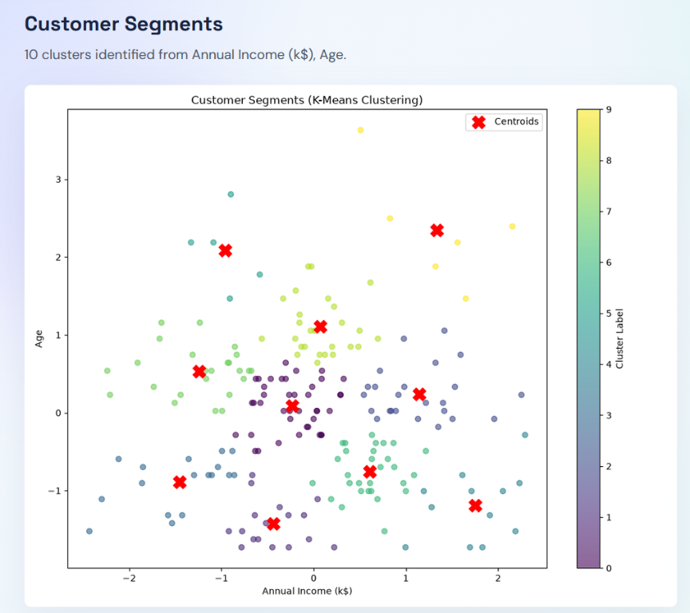

# Customer Segmentation Dashboard

An end-to-end customer segmentation application built with **Python, FastAPI,
React, TypeScript, and K-Means clustering**. Upload a CSV or Excel dataset,
explore its numeric features, evaluate candidate cluster counts, inspect segment
insights, and export the generated data, reports, plots, and trained model.



## Highlights

- Upload and validate CSV, XLSX, and XLS datasets.
- Preview rows, column types, missing values, duplicates, and summary statistics.
- Run exploratory data analysis with generated histograms, box plots, and scatter plots.
- Select numeric features dynamically from the uploaded dataset.
- Evaluate a configurable K range with inertia and silhouette scores.
- Train reproducible K-Means models with configurable random seed and initialization count.
- View evaluation metrics, cluster summaries, visualizations, and segment insights.
- Download clustered data, cluster summaries, metrics, and the serialized model.
- Use a polished React dashboard with live dataset and analysis status.
- Run the Python test suite and frontend type/build checks locally.

## Project architecture

```text
Browser (React + TypeScript + Vite)
        │ REST/JSON, multipart upload, image/file exports
        ▼
FastAPI backend (backend/main.py)
        │
        ├── Dataset management and validation
        ├── EDA and plot generation
        ├── Preprocessing and StandardScaler
        ├── K-Means training and evaluation
        └── Reports, plots, CSV, JSON, and model exports
```

The backend uses process-local state for the active uploaded datasets and
analyses. It is intentionally designed for local academic and demonstration
workflows rather than multi-user production deployment.

## Technology stack

| Layer            | Technology                                              |
| ---------------- | ------------------------------------------------------- |
| Data processing  | Python, pandas, NumPy                                   |
| Machine learning | scikit-learn K-Means, StandardScaler                    |
| Visualization    | Matplotlib, Seaborn                                     |
| API              | FastAPI, Uvicorn, Pydantic                              |
| Frontend         | React 18, TypeScript, Vite                              |
| UI               | Tailwind CSS, custom glassmorphism design, Lucide icons |
| HTTP client      | Axios                                                   |
| Testing          | pytest, TypeScript compiler, Vite production build      |

## Requirements

- Python 3.10+ recommended
- Node.js 16+ and npm
- Windows PowerShell, macOS, or Linux
- No database, Docker daemon, or external service is required for the local workflow

## Quick start

### 1. Clone and enter the project

```powershell
git clone <your-repository-url>
cd "BA Project"
```

### 2. Set up the Python environment

Windows PowerShell:

```powershell
python -m venv venv
.\venv\Scripts\Activate.ps1
python -m pip install --upgrade pip
pip install -r requirements.txt
```

If PowerShell blocks activation, use:

```powershell
Set-ExecutionPolicy -ExecutionPolicy RemoteSigned -Scope Process
```

macOS/Linux:

```bash
python3 -m venv venv
source venv/bin/activate
python -m pip install --upgrade pip
pip install -r requirements.txt
```

### 3. Install frontend dependencies

```powershell
cd frontend
npm install
cd ..
```

## Run the full application

Open two terminals from the project root.

Terminal 1 — backend:

```powershell
.\venv\Scripts\python.exe -m uvicorn backend.main:app --host 127.0.0.1 --port 8000
```

Terminal 2 — frontend:

```powershell
cd frontend
npm run dev
```

Open [http://localhost:5173](http://localhost:5173).

The Vite development server proxies `/api` requests to
`http://localhost:8000`. The API health endpoint is available at
[http://localhost:8000/api/health](http://localhost:8000/api/health), and FastAPI's interactive documentation is
available at [http://localhost:8000/docs](http://localhost:8000/docs).

## Run the command-line pipeline

The original batch workflow can run independently of the web dashboard:

```powershell
.\venv\Scripts\python.exe src/main.py `
  --data data/raw/Mall_Customers.csv `
  --features "Annual Income (k$)" "Spending Score (1-100)" `
  --k_min 2 `
  --k_max 10
```

Generated batch artifacts are written to `data/processed/` and `outputs/`.

## Test and verification commands

Run Python tests:

```powershell
.\venv\Scripts\python.exe -m pytest -q
```

Check Python syntax:

```powershell
.\venv\Scripts\python.exe -m compileall -q src backend tests
```

Check and build the frontend:

```powershell
cd frontend
npx tsc --noEmit
npm run build
```

The latest verified baseline is **30 Python tests passed with 1 expected skip**,
successful Python compilation, successful TypeScript checking, and a successful
Vite production build. See the [audit report](docs/AUDIT_REPORT.md) for the
complete evidence and known limitations.

## User workflow

1. Open **Dataset** and upload a CSV or Excel file.
2. Inspect the preview and data-quality summary.
3. Open **Exploratory Analysis**, select numeric features, and run EDA.
4. Open **Clustering**, select at least two numeric features, configure the K range,
   and run K-Means.
5. Review the evaluation page and selection rationale.
6. Inspect cluster visualizations and segment insights.
7. Download reports and model artifacts from the Reports page.

The feature controls are populated from the uploaded dataset; the frontend does
not assume the Mall Customers column names.

## API overview

| Method | Endpoint                                | Purpose                                |
| ------ | --------------------------------------- | -------------------------------------- |
| GET    | `/api/health`                         | Check API availability                 |
| POST   | `/api/datasets/upload`                | Upload CSV or Excel data               |
| GET    | `/api/datasets/{dataset_id}/preview`  | Retrieve preview rows and metadata     |
| GET    | `/api/datasets/{dataset_id}/summary`  | Retrieve quality and numeric summaries |
| DELETE | `/api/datasets/{dataset_id}`          | Delete an uploaded dataset             |
| POST   | `/api/analysis/eda`                   | Generate EDA summary and plots         |
| GET    | `/api/analysis/{id}/eda/plots/{name}` | Retrieve an EDA plot                   |
| POST   | `/api/clustering/run`                 | Run K-Means analysis                   |
| GET    | `/api/analysis/{id}/results`          | Retrieve analysis results              |
| GET    | `/api/analysis/{id}/clusters`         | Retrieve cluster summaries             |
| GET    | `/api/analysis/{id}/evaluations`      | Retrieve K-range evaluation            |
| GET    | `/api/analysis/{id}/plots/{name}`     | Retrieve clustering plots              |
| GET    | `/api/analysis/{id}/export/{type}`    | Download generated artifacts           |

## Repository layout

```text
.
├── backend/              # FastAPI application
├── data/
│   └── raw/              # Sample input dataset
├── docs/                 # Architecture, requirements, audit, and progress
│   └── assets/           # GitHub documentation images
├── frontend/             # React + TypeScript dashboard
├── outputs/              # Local generated artifacts (ignored by Git)
├── src/                  # Reusable ML and reporting modules
├── tests/                # Python unit and integration tests
├── requirements.txt
├── README.md
└── .gitignore
```

Runtime uploads, temporary files, generated outputs, virtual environments,
frontend dependencies, and build folders are excluded by
[`.gitignore`](.gitignore). Raw sample input, source code, tests, documentation,
and the README preview asset remain suitable for GitHub.

## Documentation

- [Project overview](docs/PROJECT_OVERVIEW.md)
- [Architecture](docs/PROJECT_ARCHITECTURE.md)
- [Frontend architecture](docs/FRONTEND_ARCHITECTURE.md)
- [Technology stack](docs/TECH_STACK.md)
- [Requirements](docs/REQUIREMENTS.md)
- [Dataset documentation](docs/DATASET_DOCUMENTATION.md)
- [Algorithm explanation](docs/ALGORITHM_EXPLANATION.md)
- [Setup and execution](docs/SETUP_AND_EXECUTION.md)
- [Testing strategy](docs/TESTING_STRATEGY.md)
- [Expected outputs](docs/EXPECTED_OUTPUTS.md)
- [Implementation plan](docs/IMPLEMENTATION_PLAN.md)
- [Academic report guide](docs/ACADEMIC_REPORT_GUIDE.md)
- [Viva questions](docs/VIVA_QUESTIONS.md)
- [Project decisions](docs/PROJECT_DECISIONS.md)
- [Full audit report](docs/AUDIT_REPORT.md)
- [Development progress](docs/PROGRESS.md)

## Dataset and interpretation note

The included Mall Customers-style dataset is intended for educational use.
Customer IDs are identifiers, not behavioral features. For meaningful
segmentation, select features such as age, annual income, and spending score.
Cluster labels are arbitrary numeric IDs; interpretation should be based on
centroids and domain context.

## License

This project is intended for academic and educational use. Add the license
appropriate for your repository before publishing it publicly.
